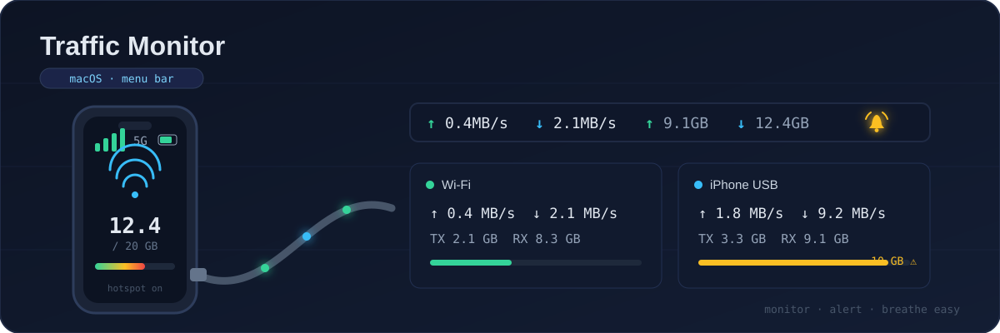
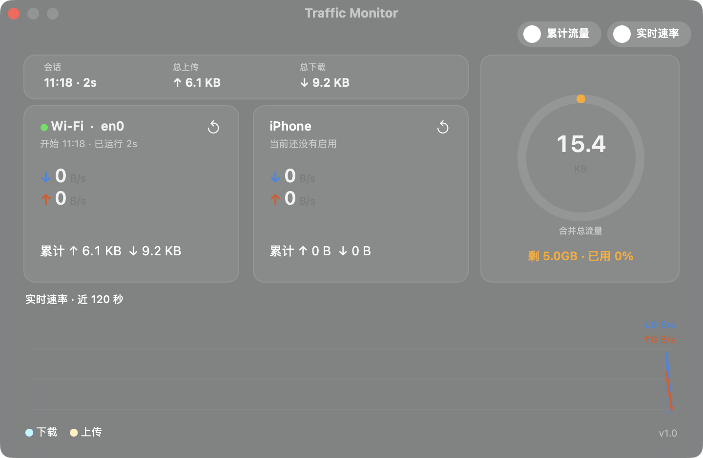
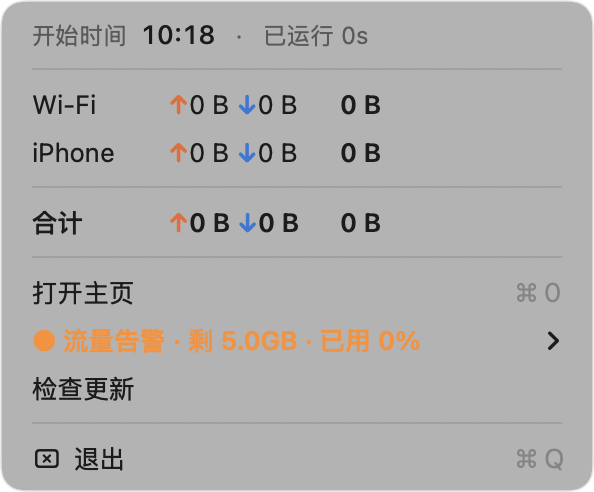

# Cellular Hotspot Network Monitor

<p align="center">
  
</p>

[](https://github.com/hajifish/Cellular-Hotspot-Network-Monitor/actions/workflows/ci.yml)
[](LICENSE)


*简体中文 | [English](README.en.md)*

<p align="center">
  
</p>

> ### 📱 用手机流量给电脑联网？最怕的就是不知不觉跑超套餐。
>
> **Traffic Monitor 常驻菜单栏，帮你盯紧每一 MB：** Wi-Fi 与 USB 共享 iPhone
> 的流量分开计量、实时速率每秒刷新；总流量一到设定的档位——**默认支持按每
> 1 GB 一档告警**（1 / 2 / 5 / 10 / 20 GB，越线即报）——立刻柔和钟声 +
> 系统通知。套餐用量有多少，一抬眼就知道，不再靠猜。

## 界面预览

<p align="center">
  <br>
  <em>主页窗口：会话摘要、双接口卡片（含独立重置）、近 120 秒速率曲线</em>
</p>
<p align="center">
  <br>
  <em>菜单栏：实时速率与累计流量，档位显示模式任你切换</em>
</p>

## 功能

- **菜单栏实时速率** —— 实时速率与累计流量各自为「↑ 上 / ↓ 下」两行竖排组，
  同开时并排两列，每秒刷新；都关闭时只显示软件图标
- **显示开关** —— 主页右上角两个独立开关：**实时速率**（默认开）与
  **累计流量**（默认关），点击即切换并记住
- **分类累计** —— Wi-Fi 与 iPhone USB 各自的收/发累计与**各自独立的开始时间**
- **按模块重置** —— 主页每张接口卡片右上角「重置计量」按钮，确认后仅重置该
  模块的计数与时钟；任一模块重置都会重新武装流量告警
- **流量告警** —— 以**所有模块累计上行 + 下行的合并流量**为口径，阈值可选
  关闭 / 1 / 2 / 5 / 10 / 20 GB / 自定义（如 `5 GB`、`500 MB`），按套餐预算呈现：
  设置后菜单与主页显示余量「剩 X · 已用 Y%」。达到阈值时播放柔和钟声 +
  系统通知横幅（未授权通知时回退为应用内弹窗），告警环变红。
  每个阈值只提醒一次，重置或换档后重新武装
- **主页窗口（⌘0）** —— 左列接口卡片（接口名、实时速率、累计收发、重置按钮），
  右侧**合并总流量圆环**（环 = 告警进度：素环未设置 / 橙弧进行中 / 红环已触发），
  近 120 秒滚动速率折线图（上传/下载双线，自适应浅色/深色模式）
- **自动更新** —— 基于 GitHub Releases 自动检测新版本（启动后自动检查 +
  每 6 小时轮询）；发现新版本时系统通知 + 主页「软件更新」卡片提醒，
  应用内下载（带进度）并校验后确认重启即完成更新，换包失败自动回滚旧包
- **监测自身不访问网络** —— 只读内核接口计数器；仅检查/下载更新时访问
  GitHub

## 环境要求

- Apple Silicon (arm64) Mac
- macOS 14 (Sonoma) 或更高
- Swift 5.9 工具链 —— 仅需 Command Line Tools，**无需**完整 Xcode

## 安装

从 [Releases](https://github.com/hajifish/Cellular-Hotspot-Network-Monitor/releases)
下载 DMG（拖进 Applications）或 ZIP（解压即用）——发布 Release 时 CI 会自动
打包并挂到 Release 页（仅 Apple Silicon）。

> 应用为 ad-hoc 签名（无公证），首次打开若被 Gatekeeper 拦截：右键点击应用
> → 「打开」，或执行
> `xattr -d com.apple.quarantine "/Applications/Traffic Monitor.app"`。

## 构建与运行

```bash
swift build                                  # 构建
./scripts/make-app.sh                        # 生成 "Traffic Monitor.app"
open "Traffic Monitor.app"
```

或直接运行构建产物：

```bash
.build/debug/TrafficMonitor
```

### 诊断开关

| 环境变量 | 作用 |
|---|---|
| `TRAFFICMONITOR_SELFTEST=1` | 运行内置自测后退出（退出码报告结果，当前 210 项） |
| `TRAFFICMONITOR_SHOWHOME=1` | 启动即打开主页窗口 |
| `TRAFFICMONITOR_ALERT_MB=1` | 启动即设 1MB 告警阈值（验证告警链路用） |
| `TRAFFICMONITOR_AUTOUPDATE=1` | 发现新版本即自动下载并跳过确认弹窗直接重启更新（验证升级链路用） |

## 实现原理

- 字节计数走 `sysctl(NET_RT_IFLIST2)` 的 64 位 `if_data64`（与 `netstat -ib`
  同源；`getifaddrs` 在 macOS 暴露的是 32 位 `if_data`，会回绕）。
- 接口分类：Wi-Fi 按接口类型 `IEEE80211`；iPhone USB 按硬件端口显示名含
  "iPhone"（`SCNetworkInterfaceGetLocalizedDisplayName`）。
- 速率为相邻两次采样的每秒增量；各模块的累计与开始时间相互独立，重置仅影响
  对应模块。告警阈值记忆在 `UserDefaults`。

## 开发

单一 SwiftPM 可执行 target，AppKit UI（`NSStatusItem` + `NSWindow`），无第三方依赖。

在 CLT 工具链下 XCTest 不可用，因此自测套件内置在主程序里，以
`TRAFFICMONITOR_SELFTEST` 环境变量进入。改动行为时请同步扩展
`Sources/TrafficMonitor/SelfTest/` 中的自测。

设计文档见 `docs/superpowers/specs/`，实现计划见 `docs/superpowers/plans/`。

## 参与贡献

欢迎贡献！项目采用
[Gitflow](https://www.atlassian.com/git/tutorials/comparing-workflows/gitflow-workflow)
分支模型：从 `develop` 分出 `feature/*` 或 `bugfix/*` 分支，PR 一律指向
`develop`。构建方法、提交规范与 PR 清单见 [CONTRIBUTING.md](CONTRIBUTING.md)
（英文版见 [CONTRIBUTING.en.md](CONTRIBUTING.en.md)）。

## 许可证

[MIT](LICENSE) © Shin L (hajifish)
