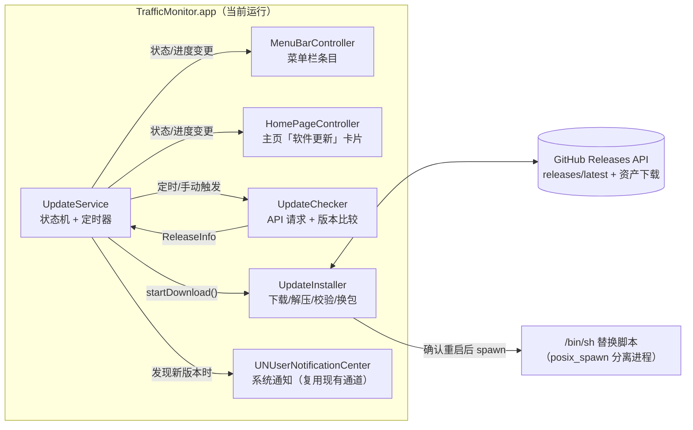
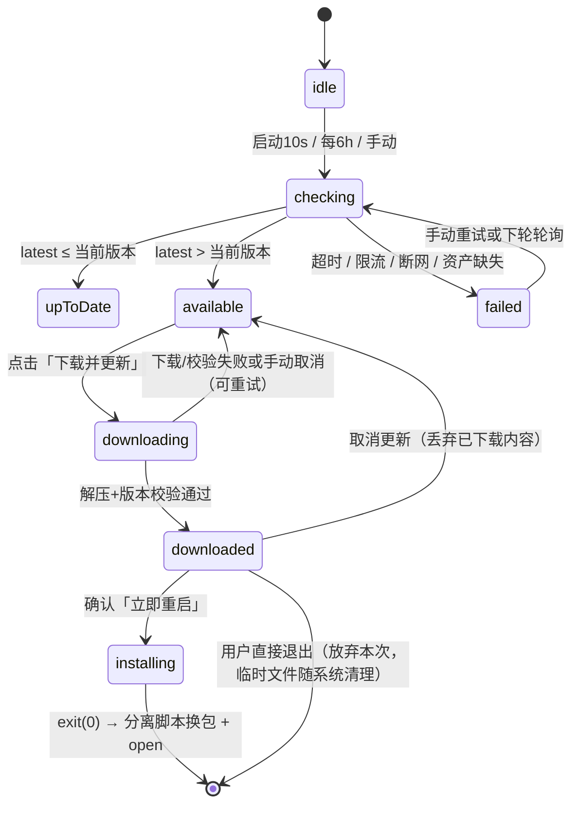
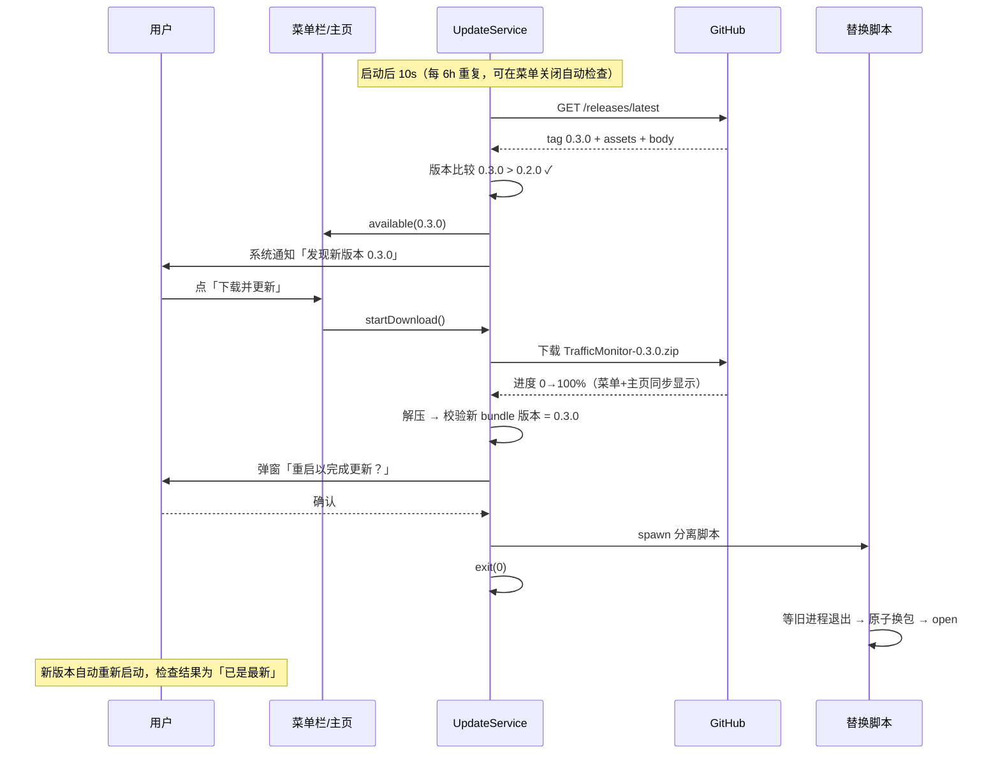

# 应用自动更新设计 — 基于 GitHub Releases 的检测 / 下载 / 换包 / 重启

日期：2026-10-29
状态：已确认（用户批准后实施）

## 目标

1. 客户端自动检测 GitHub Releases 上的新版本（不架设自有服务器）
2. 应用内直接下载安装包、替换旧版本并自动重启（用户确认后重启）
3. 用户在每次打开软件时、以及软件运行过程中，都能收到更新提醒
4. 菜单栏提供版本号与升级状态的常驻展示

## 决策记录

| 决策点 | 结论 |
|---|---|
| 更新方案 | **自研轻量更新器**（方案 A）：GitHub Releases API + URLSession 下载 + 分离脚本换包。零第三方依赖，全部逻辑纳入内置自测 |
| 否决项 | Sparkle 2（需 appcast 托管 + EdDSA 体系 + xcframework，无 Xcode 环境风险高，破坏零依赖）；纯跳转发布页（不满足应用内更新需求，降级保留） |
| 重启时机 | 下载完成后**弹窗确认**「立即重启完成更新」，用户确认才换包重启（用户决策）；选「稍后」则菜单保留「重启以完成更新」入口 |
| 检查时机 | 启动后 10s 首查 + 每 6 小时轮询 + 菜单「检查更新…」手动触发 |
| 版本通道 | 仅正式版：`GET /repos/hajifish/Cellular-Hotspot-Network-Monitor/releases/latest`（端点天然排除 draft/prerelease） |
| 下载格式 | Release 资产中的 `TrafficMonitor-*.zip`（忽略 DMG） |
| 提醒渠道 | 系统通知（复用现有 UNUserNotificationCenter，点击打开主页更新卡片）+ 主页「软件更新」卡片；每次启动检测到新版都提醒，运行中同一版本只提醒一次 |
| 更新入口 | **主页卡片是唯一更新入口**（用户决策 2026-10-30）：菜单栏不展示任何更新内容；无新版本时卡片仅显示当前版本号 |
| 开发构建 | `swift run`（无 bundle 版本，视为 0.0.0）自动检查关闭；手动检查仅展示结果与发布页链接，不做应用内安装 |
| 降级路径 | `.app` 所在目录不可写、资产缺失等异常 → 引导打开发布页手动安装 |
| 明确不做 | 「跳过此版本」、预发布通道、后台静默预下载、增量更新、校验和资产（将来可在 CI 附加 `.sha256` 后再启用校验） |

## 架构



新增文件（平铺在 `Sources/TrafficMonitor/`，与现有风格一致）：

- **`UpdateModels.swift`** — `ReleaseInfo` / `ReleaseAsset`（Codable，对应 GitHub API 字段）；`AppVersion`（读 `Bundle.main` 的 `CFBundleShortVersionString`，缺失视为开发构建 `0.0.0`）；语义化版本比较（去 `v` 前缀 → 按 `-` 截断后缀 → 逐段数字比较，段数不足补零）。
- **`UpdateChecker.swift`** — 请求 `releases/latest`（`Accept: application/vnd.github+json`，10s 超时，自动走系统代理）；从 `assets` 中选 `TrafficMonitor-*.zip`（优先文件名含目标版本者）；无匹配资产返回 `nil`。
- **`UpdateInstaller.swift`** — 下载 ZIP 到临时目录（downloadTask，进度回调含字节数/总大小）→ `unzip` 解压 → **读新 bundle Info.plist 校验版本号 == 目标 tag** → 生成替换脚本写入临时目录 → `Process` 分离执行（实施修正：本机 SDK 将 `posix_spawnattr_t` 导入为不透明指针、签名不匹配；父进程 `exit(0)` 属正常退出不会终止子进程，且脚本自带 `kill -0` 等待环，时序无关紧要，故改用与项目既有用法一致的 `Process`）。
- **`UpdateService.swift`** — `@MainActor` 状态机，UI 唯一对接点；持有定时器；checker/installer 经协议注入，自测可换 fake。

### 替换脚本（换包原子性核心）

`Traffic Monitor.app` 路径含空格，脚本中所有路径严格加引号：

```sh
#!/bin/sh
# $1=旧 .app 绝对路径  $2=新 .app 绝对路径  $3=旧进程 pid  $4=日志文件
for i in $(seq 1 150); do kill -0 "$3" 2>/dev/null || break; sleep 0.1; done  # 最多等 15s
mv "$1" "$1.old-<时间戳>"                              # 运行中可改名，不影响已映射代码段
mv "$2" "$1" || { mv "$1".old-* "$1"; exit 1; }        # 换入失败则回滚
open "$1" && rm -rf "$1".old-*                         # 启动成功才清理历代旧包
```

- 换的是**目录名**而非运行中的二进制；新包就位后才 `open`（旧进程已确认退出，避免 `open` 复用旧进程）。
- 脚本为分离进程（`Process` 启动，见上文实施修正），主程序 `exit(0)` 不影响其执行。
- 中途崩溃的残留：`.old-*` 目录由下一次成功更新顺手清理，自愈。

## 状态机



## 时序



## UI 设计

**菜单栏**：不展示任何更新相关内容（用户决策 2026-10-30，替代初稿的菜单更新区方案）；更新提醒与操作全部收敛到主页卡片。

**主页「软件更新」卡片**（窗口底部，唯一更新入口）：

```text
── 无新版本 ────────────    ── 发现新版本 ──────────    ── 下载中 ──────────────
当前版本 0.2.0               发现新版本 v0.3.0            正在下载更新 45%
                            - 修复 en7 采样回绕          [取消下载]
                            - 新增自动更新
                            [下载并更新] [打开发布页]     ── 待重启 ──────────────
                                                         v0.3.0 已就绪，重启后生效
                                                         [重启以完成更新] [取消更新]
```

发现新版时展示发布说明（GitHub `body` 为 Markdown，按纯文本最多显示前 8 行 / 约 300 字符，超出以「…」收尾，完整内容经「打开发布页」在浏览器打开；不引入渲染依赖）。检查失败时保持版本号展示、备注行显示原因。系统通知：复用现有授权与发送通道（启动时已 requestAuthorization）；点击通知打开主页更新卡片。

## 关键细节

- **Gatekeeper**：HTTPS 全程；应用自身 URLSession 下载且未启用 `LSFileQuarantineEnabled`，新包无 `com.apple.quarantine` 属性，ad-hoc 签名照常启动，全程无系统弹窗。
- **网络与限额**：无鉴权 API 限额 60 次/时/IP，每实例每天约 4 次检查绰绰有余。
- **失败处理矩阵**：

| 场景 | 行为 |
|---|---|
| API 超时 / 断网 / 403 限流 | 计入 `failed`，主页显示原因 + 重试；菜单静默保留上次结果 |
| ZIP 资产缺失（CI 打包失败） | `failed`，提示「安装包未就绪」+ 打开发布页 |
| 下载中断 / 校验不符 / 解压失败 | 回到 `available` 可重试；临时文件清理；校验不符时**绝不安装** |
| 换包脚本 `mv` 失败 | 脚本自动回滚旧包；应用需手动重开，数据无损 |
| `.app` 目录不可写 | 降级：提示并打开发布页手动安装 |
| 换包成功但 `open` 失败 | 新包已在原位，用户手动打开即可 |

## 测试（并入 `TRAFFICMONITOR_SELFTEST`）

- 版本比较：`0.10.0`>`0.9.0`、`v` 前缀、`-beta` 后缀截断、段数补零、相等。
- Release JSON 解码与资产挑选（内嵌 GitHub API fixture；验证选中 zip、忽略 dmg/其他）。
- 状态机全路径迁移（注入 fake checker/installer，含失败与取消路径）。
- 替换脚本文本生成：路径含空格时的引号正确性、参数齐全。
- 真实 API 集成自测（与现有 ping 网关实时测试同风格）：请求仓库 `releases/latest` 并解码成功。

## 验收

1. `swift run TrafficMonitor` 自测全绿（含新增用例，总数随之增长）。
2. 开发构建手动「检查更新」：能取到仓库真实 latest 并正确判定为「已是最新」（当前 0.1.0），仅展示发布页链接。
3. 打包 `.app` 运行：菜单版本区、自动检查开关、手动检查、通知行为符合 UI 设计。
4. 「下载→确认→换包→重启」端到端链路：待下一次真实 Release 验证（或临时发一个测试 Release 验证后删除）；自测与真实 API 检查先行把关。
5. 文档同步：README 功能简介、CHANGELOG 条目。

## 实施影响面

- 新增 5 个源文件（UpdateModels / UpdateChecker / UpdateInstaller / UpdateService / UpdatePresentation，约 700 行）+ `SelfTest/Update*Tests.swift` 五个测试文件。
- 修改：`TrafficMonitorApp.swift`（菜单接入与启动定时）、`HomePageController.swift`（更新卡片）、`Package.swift` 无需变更（零新依赖）。
